# Web Authorization for DeepSeek Harness

A TypeScript contribution that brings registered authorization flows to Harness Web, through the existing Models settings page. Provider plugins keep their login protocols and credential writes; a reusable companion supplies the browser interaction.

**Status:** completed and tested in a public fork, based on DeepSeek Harness **0.2.0-rc.2**. The companion packages are opt-in and have not been published to npm. This page describes the fork implementation, not an upstream release or endorsement.

| Review unit | Public source |
| --- | --- |
| Web companions | [feat/web-authorization-v020](https://github.com/virtuo0ss0/deepseek-harness/tree/feat/web-authorization-v020) · [313a6bbab28d23e94e4a165ed5c810a94052f8c5](https://github.com/virtuo0ss0/deepseek-harness/commit/313a6bbab28d23e94e4a165ed5c810a94052f8c5) |
| Independent shutdown fix | [fix/authorization-shutdown-v020](https://github.com/virtuo0ss0/deepseek-harness/tree/fix/authorization-shutdown-v020) · [eee38bf001c41f62be109d01dab5687ab8744eef](https://github.com/virtuo0ss0/deepseek-harness/commit/eee38bf001c41f62be109d01dab5687ab8744eef) |
| Lifecycle bug report | [Discussion #8600: AuthorizationService shutdown races with admitted credential writes](https://github.com/deepseek-ai/deepseek-harness/discussions/8600) |

## The contribution

Harness already provides a transport-independent authorization service and provider-owned login flows. This contribution gives those flows a generic Web consumer: list methods, begin an attempt, show notices, answer text/secret/select prompts, cancel owned work, and display settlement.

| Package | Responsibility |
| --- | --- |
| [`@deepseek-ai/dsh-web-authorization`](https://github.com/virtuo0ss0/deepseek-harness/blob/313a6bbab28d23e94e4a165ed5c810a94052f8c5/packages/credentials/web-authorization/README.md) | Host-side Remote service, bounded interaction state, attempt ownership and expiry. |
| [`@deepseek-ai/dsh-client-ui-authorization`](https://github.com/virtuo0ss0/deepseek-harness/blob/313a6bbab28d23e94e4a165ed5c810a94052f8c5/packages/client/ui-authorization/README.md) | Browser consumer in the public `settings.models.footer` slot, localized UI and sequential polling. |

The implementation reuses current Loader/Gateway infrastructure. It adds neither an OAuth engine nor a credential store, replaces no provider editor, and requires no Cordis core change. Existing API-key editors and `keyConfigured` semantics remain unchanged.

## Architecture

```mermaid
flowchart LR
    subgraph Browser["Browser · transient interaction"]
        UI["Models footer<br/>ui-authorization"]
    end
    subgraph Host["Host · protocol and credential ownership"]
        Gateway["Authenticated<br/>Remote / Gateway"]
        Companion["web-authorization<br/>attempts and leases"]
        Authorization["Existing<br/>AuthorizationService"]
        Credentials["Existing<br/>credential provider"]
        Flow["Registered<br/>provider-owned flow"]
    end
    UI -->|"list / begin / status / answer / cancel"| Gateway
    Gateway --> Companion
    Companion --> Authorization
    Authorization -->|"session.commit()"| Credentials
    Authorization -->|"execute"| Flow
    Flow -->|"provider adapter writes"| Credentials
    Companion -.->|"bounded notices, prompts, outcome"| Gateway
    Gateway -.->|"credential payloads excluded"| UI
    classDef browser fill:#eff6ff,stroke:#2563eb,color:#172554
    classDef host fill:#f8fafc,stroke:#64748b,color:#0f172a
    classDef store fill:#ecfdf5,stroke:#047857,color:#064e3b
    class UI browser
    class Gateway,Companion,Authorization,Flow host
    class Credentials store
```



The provider flow owns OAuth callbacks and persistence. It can use `session.commit()` or its existing credential adapter; the companion never receives the resulting grant. The diagram is also exported as [architecture.mmd](architecture.mmd).

## Security and lifecycle decisions

- **Host-only credentials.** Access/refresh tokens, PKCE verifiers, grants and credential-store contents stay on the Host. Browser responses contain selected flow metadata, bounded notices/prompts and outcomes. Only validated public `pollMs` configuration enters the page bootstrap; providers must keep notice/prompt metadata free of credentials.
- **Correlated actions.** A random, browser-created attempt capability stays in memory. Answers also carry the current prompt identity; stale answers and cancellations cannot target a replacement attempt. The directory exposes no other client's capability. Installed Host plugins and same-origin scripts remain trusted.
- **Bounded state.** The Host retains at most 32 attempts and 16 notices per attempt; a serialized attempt view is capped at 32 KiB. Secret answers are transient browser input sent to the Host; input clears on submission, prompt replacement and unmount, and answers are excluded from controller snapshots and browser storage. This is observable non-retention, not guaranteed JavaScript heap erasure or transport encryption.
- **Lease ownership.** Sequential polling renews the live lease. Brief disconnects retain the same attempt; full-page reload loses its capability and abandoned work expires. Disposal clears prompts, listeners, timers and Remote/UI registrations. Cancellation never promises rollback of an admitted credential write.
- **Owner-correct shutdown.** The lifecycle foundation recognizes admission inside the provider's mutation callback, drains admitted commits, and rejects new work during unloading. During shutdown, confirmed durable `session.commit()` success can settle without a further read from a disposing provider. Normal completion still rechecks the record, so later deletion cannot masquerade as success.

> **Compatibility:** complete shutdown guarantees require the patched AuthorizationService in `eee38bf001c41f62be109d01dab5687ab8744eef`. Unmodified upstream **0.2.0-rc.2** does not contain this fix. The pinned feature commit includes it as its parent; a package version range alone does not establish the guarantee. Credential providers retain their queued-write/disposal behavior, and no public API signature or Cordis implementation changed in the foundation fix.

## Reproduce from source

The recorded acceptance used native Windows, Node **24.13.0** and repository-pinned pnpm **11.7.0**. The examples below use PowerShell. See the pinned [development guide](https://github.com/virtuo0ss0/deepseek-harness/blob/313a6bbab28d23e94e4a165ed5c810a94052f8c5/docs/development.md) for native build prerequisites and other platforms.

### 1. Obtain the tested revision and build

```powershell
git clone --single-branch --branch feat/web-authorization-v020 https://github.com/virtuo0ss0/deepseek-harness.git
Set-Location deepseek-harness
git checkout --detach 313a6bbab28d23e94e4a165ed5c810a94052f8c5
pnpm install --frozen-lockfile
pnpm run build
```

### 2. Run the credential-free deployed-browser acceptance

If matching Chromium binaries are absent, install them with `pnpm --filter @deepseek-ai/dsh-web-frontend exec playwright install chromium`. The suite uses synthetic flows, isolated state and the actual built Web application with real HTTP/WebSocket traffic.

```powershell
$previousSnapshot = $env:DSH_SNAPSHOT
try {
    $env:DSH_SNAPSHOT = 'replay'
    pnpm run test:web:built apps/web/tests/web-authorization.e2e.ts
} finally {
    $env:DSH_SNAPSHOT = $previousSnapshot
}
```

Expected at the pinned revision: **12 passed, 0 failed, 0 skipped**. No provider account or real OAuth is required.

### 3. Preview the footer in the normal Web application

<details>
<summary>Isolated source-checkout configuration and launch</summary>

Use a fresh checkout without a project `.env` and a shell without inherited provider credentials. The normal CLI reads invoking-directory and Harness-home `.env` files. This example creates a new temporary Harness home and mounts only the two additional companions; the shipped Web/base composition already supplies Gateway, one authorization service, one credential provider and the pi-ai adapter.

The source-preview overlay resolves the companions by their built file URLs. They are ordinary plugins, not `dsh plugin add` bundles; a separate installation must make their package dependency closure resolvable.

```powershell
$checkout = (Get-Location).Path
$preview = Join-Path ([IO.Path]::GetTempPath()) ('dsh-web-auth-' + [guid]::NewGuid().ToString('N'))
New-Item -ItemType Directory -Path $preview | Out-Null
$entries = @(
    @{
        id = 'web-authorization'
        name = ([uri](Join-Path $checkout 'packages/credentials/web-authorization/lib/index.js')).AbsoluteUri
        config = @{ leaseMs = 60000 }
    },
    @{
        id = 'ui-authorization'
        name = ([uri](Join-Path $checkout 'packages/client/ui-authorization/lib/index.js')).AbsoluteUri
        config = @{ pollMs = 1000 }
    }
)
$patch = @(
    @{ id = 'web-runtime'; config = @{ openBrowser = $true; printUrl = $false; surfaceContext = $true; trustedHosts = @() } },
    @{ insert = $entries }
)
$overlay = Join-Path $preview 'companions.overlay.json'
[IO.File]::WriteAllText($overlay, (ConvertTo-Json -InputObject $patch -Depth 8), [Text.UTF8Encoding]::new($false))
$previousHome = $env:DSH_HOME
$previousTelemetry = $env:DSH_TELEMETRY_DISABLED
try {
    $env:DSH_HOME = Join-Path $preview 'home'
    $env:DSH_TELEMETRY_DISABLED = '1'
    pnpm run start:web --patch $overlay
} finally {
    $env:DSH_HOME = $previousHome
    $env:DSH_TELEMETRY_DISABLED = $previousTelemetry
}
```

Keep port 3080 available; the OpenAI Codex OAuth callback also needs port 1455 if you choose to sign in. Use the shipped authenticated browser opener. On first launch, dismiss the preview notice and choose **Configure later** if API-key setup appears; no key is needed for this preview. Then open **Settings → Models → Provider authorization**. Merely viewing the directory needs no provider login. A selected flow presents its registered method, notices and prompts; successful settlement displays **Authorization completed**. Perform provider login/consent manually and keep bearer URLs, credentials and callback details out of shared logs. Stop the preview gracefully with Ctrl+C.

`leaseMs` accepts integer milliseconds from 1000 to 3600000; `pollMs` accepts 250 to 10000. Keep the lease above the polling interval and expected reconnect gaps. Browser configuration is delivered through the existing Webserver page injection mechanism. A page reload applies Host configuration changes.

`surfaceContext = $true` follows the shipped Web profile: it supplies the clean local Web address to model context and shell variables, not an authenticated bootstrap URL. It is optional orientation and is not required to mount this footer. `trustedHosts = @()` is appropriate for this loopback-only preview: it adds no extra Host authorities and preserves the shipped trust fence. Do not use these preview settings as a public/LAN deployment recipe.

**Preview cleanup:** Ctrl+C stops the Host; wait for it to exit before removing preview state. The `finally` block restores the previous environment but does not delete `$preview` or its isolated `$preview/home`. If you voluntarily complete a provider login, treat that home as private credential storage. Remove the test record through the existing credential provider, or, after shutdown, discard only the generated `$preview` directory and all its isolated state. Never delete your normal Harness home. Local removal is not issuer-side revocation; manage issuer permissions separately if needed.

The pi-ai adapter registers login flows before model routes are configured. The generic consumer does not initialize private provider-owned account services; flows needing those services must use their owning UI.

</details>

## Verification recorded for this contribution

These are local acceptance results for the reviewed 0.2.0-rc.2 port, not claims of upstream CI approval or a full repository test run. See the committed [Host companion acceptance summary](https://github.com/virtuo0ss0/deepseek-harness/blob/313a6bbab28d23e94e4a165ed5c810a94052f8c5/packages/credentials/web-authorization/README.md#dev-note).

| Evidence | Result and scope |
| --- | --- |
| Focused tests | **94/94** authorization, credential record/drain and companion tests passed. |
| Relevant upstream integrations | **442/442** tests passed across pi-ai login/auth/Loader, Gateway Host/Client, Client Loader/entries, Webserver and Models apply/components/store. |
| Deployed browser | **12/12**, zero skips, using Vitest + Playwright and the built Web scaffold. |
| Builds and package checks | Host/Client/Web build and typechecks, focused lint, package/export validation, generated-artifact freshness and documentation checks passed. |
| Fresh installed-package proof | A fresh **118-artifact** dependency closure installed with scripts disabled. One compatible Cordis runtime and one patched authorization service; no checkout-source links or TypeScript aliases. Both plain-Node Gateway and Loader checks passed. |
| Real provider acceptance | Human-performed `llm-pi-ai/openai-codex` / ChatGPT OAuth succeeded through the generic Web consumer on this port. |

<details>
<summary>The 12 deployed-browser scenarios</summary>

1. Models-footer directory and public browser bootstrap.
2. Bounded notices, text/secret/select prompts, observable secret non-retention and successful settlement.
3. Owned cancellation and stale attempt/prompt rejection.
4. Brief HTTP/WebSocket interruption and recovery with the same attempt.
5. Full-page reload and abandoned-lease expiry.
6. Models-panel disposal.
7. Browser disposal.
8. UI-plugin disposal and remount.
9. Provider-scope disposal.
10. Admitted write draining on companion disposal after lease expiry.
11. Admitted write draining on root/scaffold disposal after lease expiry.
12. Cancellation of a write queued before provider admission during root disposal.

The [browser spec](https://github.com/virtuo0ss0/deepseek-harness/blob/313a6bbab28d23e94e4a165ed5c810a94052f8c5/apps/web/tests/web-authorization.e2e.ts) and [synthetic fixture](https://github.com/virtuo0ss0/deepseek-harness/blob/313a6bbab28d23e94e4a165ed5c810a94052f8c5/apps/web/tests/web-authorization-fixture.ts) preserve real transport and deterministic credential-admission barriers.

</details>

Installed-package checks are separate from deployed-browser acceptance: [`built-smoke.mjs`](https://github.com/virtuo0ss0/deepseek-harness/blob/313a6bbab28d23e94e4a165ed5c810a94052f8c5/packages/credentials/web-authorization/tests/built-smoke.mjs) and [`external-composition.mjs`](https://github.com/virtuo0ss0/deepseek-harness/blob/313a6bbab28d23e94e4a165ed5c810a94052f8c5/packages/credentials/web-authorization/tests/external-composition.mjs) exercise the installed Gateway/Loader composition under plain Node.

Real OAuth verification inspected only the matching `authorized` settlement and credential descriptors: `configured: true`, `kind: grant`, `writable: true`. No prompt or active attempt remained; manual page reload succeeded, and the grant survived graceful Host restart without another login. Cleanup deleted only the isolated test credential, confirmed `configured: false`, and gracefully stopped the isolated Host with ports released. Credential payloads and account identifiers were not inspected or exported.

The historical [0.1.7-based implementation](https://github.com/virtuo0ss0/deepseek-harness/tree/feat/web-authorization-v017) also passed real OAuth acceptance independently. That earlier result is distinct from the completed 0.2.0-rc.2 acceptance above.

## Limits and scope

- **Authorization is not model-route configuration.** A stored grant does not create a provider route or select a model. Model inference was not tested in this acceptance.
- **Refresh remains provider-owned.** Token refresh behavior was not exercised; this contribution adds no refresh engine or multi-account pooling.
- **Cancellation and local deletion are not issuer revocation.** Neither revocation nor another application's logout was performed or claimed.
- **Attempts are transient.** Host restart loses active attempts; page reload abandons ownership. Persisted credentials are a separate concern.
- **Generic interaction has prerequisites.** A registered flow must work through the existing notice/prompt interface and its provider-owned services. Private account initialization is not bypassed. Authentication and trusted same-origin code remain part of the security model.

This contribution focuses on a reusable browser interaction layer, explicit lifetime ownership and evidence that the same packages work both inside the repository and in an installed composition.
